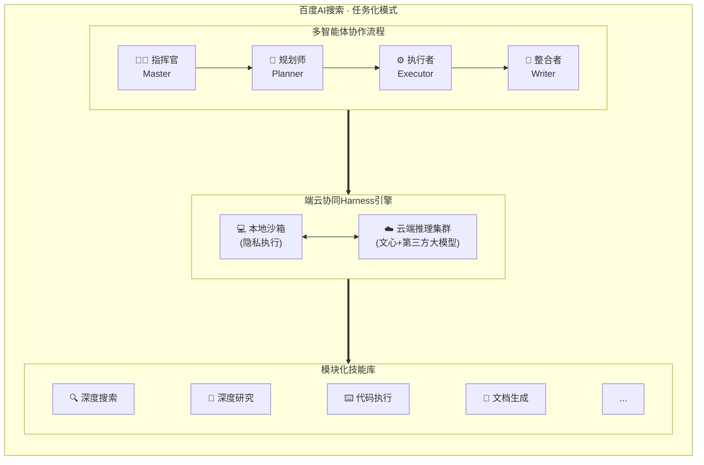

# 产品介绍

  

<h1 style={{ textAlign: 'center' }}>🚀 欢迎来到 百度AI搜索 (Orion-Mission-Mode)</h1>

  <strong>下一代智能搜索范式：从「给答案」到「交结果」</strong>

  <strong><a href="https://wenxin.baidu.com">产品入口</a></strong>
  &nbsp;|&nbsp;
  <strong><a href="https://github.com/Baidu-AI-Search/Orion-Mission-Mode">PinchBench榜单结果</a></strong>
  {/* &nbsp;|&nbsp;
  <strong><a href="./illustration.md">评估说明</a></strong> */}

---

## 💻 产品介绍

**百度AI搜索任务化模式Orion-Mission-Mode**是百度搜索在AI时代的重大范式升级，标志着搜索引擎从传统信息检索系统向智能任务执行平台的全面转型。依托百度在搜索、大模型、知识图谱领域十余年的技术积累，结合自研文心大模型与端云协同Harness执行引擎，任务化模式让用户只需用自然语言描述目标，系统即可自动完成任务拆解、多步推理、工具调度与端到端结果交付。

与传统RAG（检索增强生成）式AI搜索仅能从检索文档中合成答案不同，任务化模式构建了完整的多智能体协作架构，能够跨工具、跨服务执行复杂的多步工作流，真正实现从「百度一下，你就知道」到「百度一下，你就做到」的体验升级。

---

## 🛠️ 核心能力

### 🎯 意图理解与任务拆解
自动理解用户模糊、复杂的自然语言指令，将高层目标拆解为结构化的有向无环图（DAG）任务工作流，无需用户手动提炼关键词或编排执行步骤。

### 🔧 多工具协同调度
内置完善的工具体系，包括但不限于：
- **深度搜索引擎** — 跨平台语义检索与高价值信息精准定位
- **代码解释器** — 数据分析、文件处理、自动化脚本执行
- **文档生成** — 自动报告撰写、演示文稿制作、电子表格处理
- **浏览器自动化** — 网页导航、信息提取、表单提交
- **MCP生态接入** — 通过模型上下文协议接入多种第三方服务能力

### ⚡ 端云协同Harness架构
- **隐私本地执行** — 敏感操作在本地沙箱内完成，保障数据安全
- **云端规模推理** — 复杂推理任务自动调度云端算力，无需手动切换
- **上下文按需组装** — 根据任务语义与用户历史精准注入相关背景信息，减少冗余干扰
- **持续迭代优化** — 基于历史执行轨迹不断优化执行路径，让不同模型均能稳定运行于能力上限

### 🔒 企业级安全可信
- 本地沙箱隔离，文件夹级权限精细管控
- 高危操作二次确认机制
- 通过中国信通院复杂任务规划执行、可信能力双项认证，均获最高等级
- 数据防泄漏、行为审计、可观测性全链路保障

---

## ⚙️ 架构概览

1. **指挥官（Master）** — 分析查询复杂度，路由至合适的工作流
2. **规划师（Planner）** — 将复杂任务拆解为可执行的DAG工作流
3. **执行者（Executor）** — 调用合适的工具完成各项子任务
4. **整合者（Writer）** — 将执行结果综合为结构化、可交付的最终输出

---

## 🏆 核心评测概览

我们对系统的各维度能力进行了严苛的基准测试，点击下方链接可查看每个 Benchmark 的**全量评估细节与可复现数据**：

| 评测基准 | 考察维度 | 综合成绩 | 详细报告入口 |
| :--- | :--- | :---: | :--- |
| **PinchBench** | 真实工作流、多步骤工具调用 | 🥇 全球第一 (94.6%) | [👉 查看详细评测仓库](https://github.com/Baidu-AI-Search/Orion-Mission-Mode) |

---

## 👨‍💻 版权说明

百度AI搜索任务化模式(Orion-Mission-Mode)是百度公司的专有产品。

---

  由百度AI搜索团队匠心打造 ❤️
   
  © 2026 百度公司 版权所有

